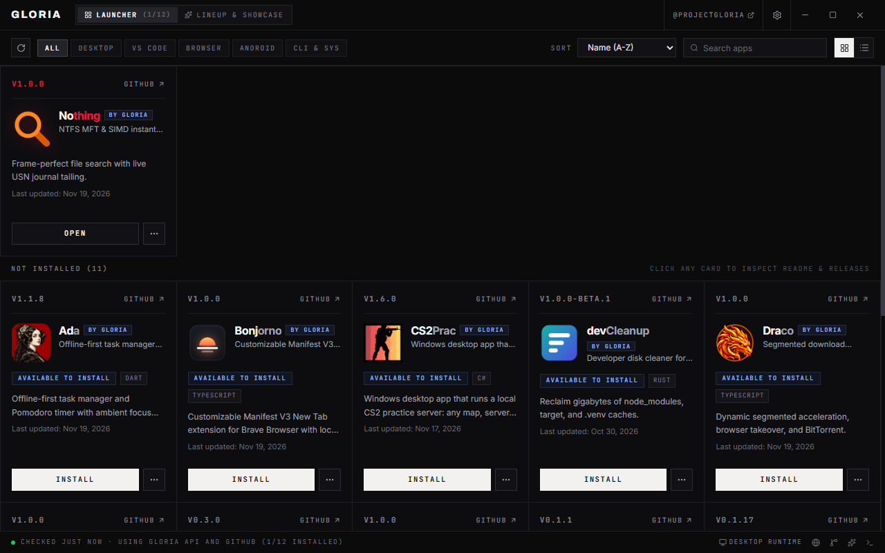
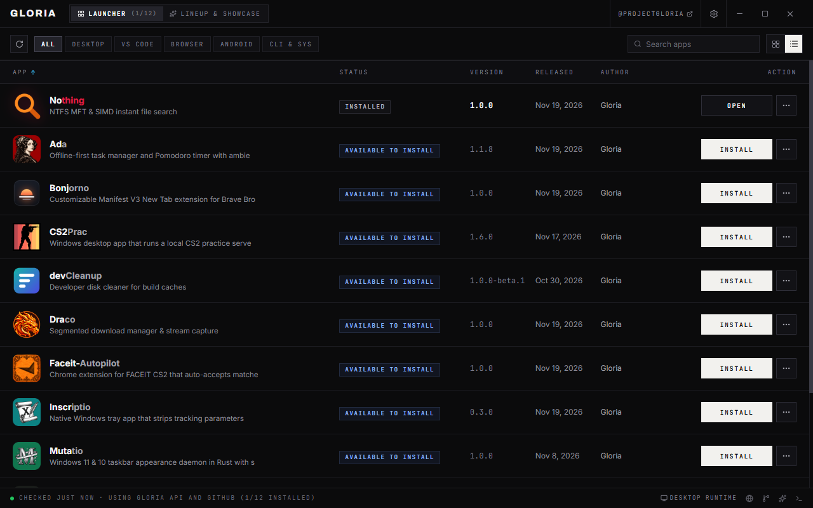
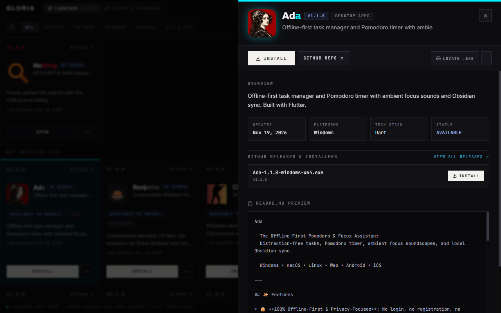
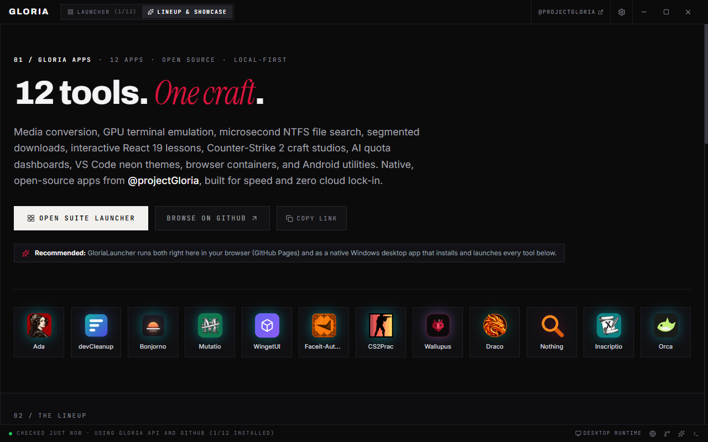
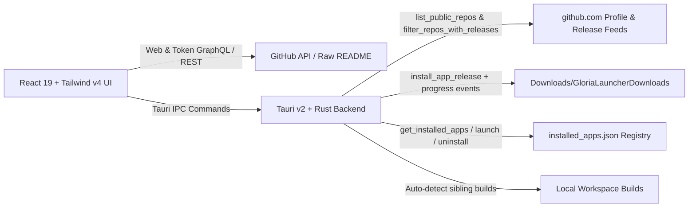

<div align="center">


# GloriaLauncher

**Desktop & web app suite launcher for `@projectGloria` releases.**

[](https://github.com/projectGloria/GloriaLauncher/actions/workflows/release.yml)
[](https://github.com/projectGloria/GloriaLauncher/releases)
[](src-tauri/Cargo.toml)
[](package.json)
[](src-tauri/tauri.conf.json)
[](LICENSE)

</div>

<p align="center">
  
</p>

<p align="center">
  <a href="#features">Features</a> •
  <a href="#screenshots">Screenshots</a> •
  <a href="#how-it-works">How It Works</a> •
  <a href="#installation">Installation</a> •
  <a href="#usage">Usage</a> •
  <a href="#building-from-source">Building from Source</a> •
  <a href="#configuration">Configuration</a> •
  <a href="#license--credits">License &amp; Credits</a>
</p>

---

## About

**GloriaLauncher** is a single-codebase desktop and web launcher for the [`@projectGloria`](https://github.com/projectGloria) application suite. It discovers public `@projectGloria` repositories that have published GitHub Releases, enriches them with curated metadata and icons, and lets you inspect documentation, download installers, and launch native Windows applications from one dark, frameless interface.

On Windows, the Tauri v2 + Rust backend streams release installers directly into your Downloads folder, extracts `.zip` bundles automatically, detects local workspace builds, and tracks installed apps in a local registry. The same React 19 frontend also builds as a standalone static web app for browsing releases and pinning tools in the browser.

## Features

- **Release-Only Live Discovery**: Automatically syncs public `@projectGloria` repositories that have real GitHub Releases (skipping bare git tags) and merges them with a curated catalog of 39 app definitions.
- **Zero-Quota Desktop Sync**: The Rust backend checks `releases.atom` feeds and expanded asset pages directly, falling back to profile-page discovery if the anonymous GitHub REST API rate limit is reached.
- **One-Click Install & Launch**: Streams `.exe`, `.msi`, and `.zip` release assets into `%USERPROFILE%\Downloads\GloriaLauncherDownloads` with live progress, auto-extracts archives to find installers, and opens installed apps directly.
- **Grid, Table & Editorial Showcase Views**: Switch between the 5-column card grid, a sortable table (`APP`, `STATUS`, `VERSION`, `RELEASED`, `AUTHOR`), and the editorial **Lineup & Showcase** overview.
- **Slide-Over App Inspector**: Inspect any app's live `README.md`, platform and tech-stack metadata, individual release assets, or bind a custom local `.exe` / `.bat` / `.cmd` executable.
- **Local Workspace Auto-Detection**: Automatically detects sibling builds inside a `Gloria Repoz` workspace and lets you rescan or link custom executables from Settings or the inspector drawer.

## Screenshots

<p align="center">
  
  <br /><em>Launcher Grid View: installed apps pinned at the top, followed by available @projectGloria releases with category filters, search, and sorting.</em>
</p>

<p align="center">
  
  <br /><em>Compact Table View: sortable rows displaying install status, latest release tag, release date, author, and quick launch or install actions.</em>
</p>

<p align="center">
  
  <br /><em>App Inspector Drawer: live README.md preview, downloadable release assets, and local executable binding.</em>
</p>

<p align="center">
  
  <br /><em>Lineup &amp; Showcase: editorial overview of all released @projectGloria tools.</em>
</p>

## How It Works



The frontend runs inside a frameless Tauri v2 WebView2 window on Windows (or any modern browser in web mode). In desktop mode, Tauri IPC commands handle rate-limit-free release discovery, streaming downloads with progress events, `.zip` extraction, custom folder icon styling (`Gloria.ico` + `desktop.ini`), and launching installed executables via the Windows shell.

## Installation

### Windows Desktop App (Recommended)

1. Download the latest Windows installer from the [Releases](https://github.com/projectGloria/GloriaLauncher/releases) page:
   - `*-setup.exe` (NSIS installer, recommended), or
   - `*.msi` (Windows Installer package).
2. Run the installer and launch **GloriaLauncher**.
3. On first run, the launcher syncs released `@projectGloria` apps automatically.

**Requirements:** Windows 10 or Windows 11 with Microsoft Edge WebView2 Runtime (preinstalled on Windows 11 and modern Windows 10 builds).

## Usage

- **Install an app**: Click **INSTALL** on any available card (or pick a specific asset in the App Inspector drawer). GloriaLauncher downloads the preferred `.exe`, `.msi`, or `.zip` asset into `%USERPROFILE%\Downloads\GloriaLauncherDownloads` and starts the installer.
- **Launch or manage an installed app**: Click **OPEN** on an installed app to launch it, or click the `...` button to open the App Inspector where you can view its `README.md`, open its install folder, bind a different local `.exe`, or uninstall it.
- **Filter and switch views**: Use the category pills (`ALL`, `DESKTOP`, `VS CODE`, `BROWSER`, `ANDROID`, `CLI & SYS`), search box, sort dropdown, and the top-right Grid/Table toggle, or switch to **Lineup & Showcase** in the titlebar.

## Building from Source

### Prerequisites

- **Node.js** 22+ (matches `.github/workflows/release.yml`)
- **Rust** 1.80+ (`rust-version = "1.80"` in `src-tauri/Cargo.toml`)
- **Windows**: Microsoft C++ Build Tools (Desktop development with C++) and WebView2 Runtime

### Steps

1. Clone the repository and install frontend dependencies:

   ```bash
   git clone https://github.com/projectGloria/GloriaLauncher.git
   cd GloriaLauncher
   npm install
   ```

2. Run in development mode:

   ```bash
   # Web frontend dev server (http://localhost:1420)
   npm run dev

   # Native desktop app (Tauri v2 + Rust)
   npm run tauri:dev
   ```

3. Build production artifacts:

   ```bash
   # Type-check only
   npm run typecheck

   # Static web bundle (outputs to ./dist)
   npm run build:web

   # Windows NSIS (.exe) & MSI (.msi) installers
   npm run tauri:build
   ```

Desktop installers are generated under `src-tauri/target/release/bundle/nsis/` and `src-tauri/target/release/bundle/msi/`.

To run the Rust unit tests:

```bash
cd src-tauri
cargo test
```

## Configuration

<details>
<summary>Settings, storage paths, and GitHub API rate limits</summary>

- **GitHub Personal Access Token (optional)**: Open the gear icon in the titlebar to store a GitHub PAT locally in `localStorage`. When present, catalog sync uses a single GitHub GraphQL request and increases the REST API limit from 60 to 5,000 requests/hour.
- **Cache TTL**: Synced catalog and release metadata are cached locally for 15 minutes. Click the refresh button in the toolbar to force a fresh sync.
- **Desktop Download Folder**: `%USERPROFILE%\Downloads\GloriaLauncherDownloads` (styled automatically with `Gloria.ico` and `desktop.ini`).
- **Desktop Registry File**: `%LOCALAPPDATA%\com.projectgloria.launcher\installed_apps.json`.
- **Automated Releases**: Pushing a version tag matching `v*` (or triggering **Build & Release GloriaLauncher** manually in GitHub Actions) builds the Windows NSIS and MSI installers via `.github/workflows/release.yml`.

</details>

## Contributing

Issues and pull requests are welcome. See [CONTRIBUTING.md](CONTRIBUTING.md) for local setup and project layout. Before opening a PR, please verify that TypeScript and Rust checks pass:

```bash
npm run typecheck
cd src-tauri && cargo test
```

## License & Credits

[MIT](LICENSE) © [projectGloria](https://github.com/projectGloria) / [Nihil](https://github.com/Nihilnia)

Visual layout inspired by [ArtCraft](https://getartcraft.com).
